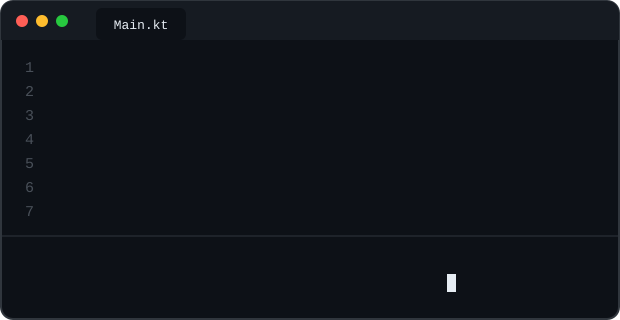

<!-- Banner animado -->

  

<!-- Saludo con mano animada -->
<h2 align="center">
  ¡Hola! Soy Gabriel
  
</h2>

<!-- Texto que se escribe solo -->

  

---

###  Sobre mí

-  Estudiante de **2.º de DAM** (Desarrollo de Aplicaciones Multiplataforma) en Madrid
-  Programo sobre todo en **Java**, y también en **Python** y **Kotlin**
-  Trabajo con **bases de datos** y ficheros (SQL, acceso a datos desde Java)
-  Aprendiendo **programación concurrente**: hilos, procesos y tareas en paralelo
-  Haciendo mis primeras **apps Android** con Kotlin
-  Con curiosidad por la **ciberseguridad**
-  Acostumbrado a trabajar **en equipo** en proyectos de clase
-  Objetivo: conseguir mis **primeras prácticas** como desarrollador

 

---

###  Tecnologías

  

---

###  Programando...

  

---

###  Mis contribuciones

  <picture>
    <source media="(prefers-color-scheme: dark)" srcset="https://raw.githubusercontent.com/gabi-valencia/gabi-valencia/output/github-snake-dark.svg" />
    
  </picture>

---

###  Contacto

  
  
  

<!-- Banner de abajo -->

